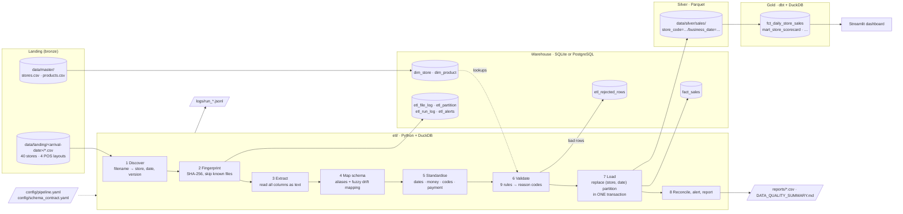

# Retail ETL Pipeline Prototype

An incremental, idempotent ETL pipeline for **Aangan Retail**, a fictional 40-store retail chain in Gurgaon. Every outlet sends a daily sales CSV. The files arrive late or twice, come in four different column layouts and contain bad rows. The pipeline:

- detects new files and checks them against a schema contract;
- maps renamed or extra columns automatically;
- standardises dates, numbers, codes and payment modes;
- sends every bad row to an error table with a reason code;
- loads clean sales into a **SQLite or PostgreSQL** warehouse.

Re-running it never double-counts a sale. On top of the warehouse sit a **Parquet** staging layer, **dbt** analytics models with data tests, and a **Streamlit** dashboard.

All amounts are in **USD**.

| Success criterion | Target | Result (reference run, 2.05M rows) |
|---|---|---|
| Daily store totals reconcile with source files | within 0.5% | **2,364 / 2,364 store-days, max variance 0.0%** |
| Rejected rows | < 2% | **1.244%** (25,469 of 2,047,269) |
| Full rerun | < 10 min | **152 s** on SQLite · **154 s** on PostgreSQL |
| Re-running the pipeline | no double counting | **0 files / 0 rows** loaded on the second run (0.5 s) |
| Matches the generator's answer key | — | **exact**: every store-day total, every reject reason count, every alert |

> For a plain-English walkthrough of how and why everything works, which tools were used and what was learnt, see **[INSIGHTS.md](INSIGHTS.md)**.

---

## Contents
1. [Pipeline diagram](#1-pipeline-diagram)
2. [Tech stack](#2-tech-stack)
3. [Repository layout](#3-repository-layout)
4. [Setup and quick start](#4-setup-and-quick-start)
5. [The dataset](#5-the-dataset)
6. [Schema contract and schema drift](#6-schema-contract-and-schema-drift)
7. [Data quality rules and reason codes](#7-data-quality-rules-and-reason-codes)
8. [Incremental and idempotent loading](#8-incremental-and-idempotent-loading)
9. [Warehouse schema](#9-warehouse-schema)
10. [Configuration](#10-configuration)
11. [Logging, alerts and reports](#11-logging-alerts-and-reports)
12. [Analytics layer (dbt) and dashboard](#12-analytics-layer-dbt-and-dashboard)
13. [Testing](#13-testing)
14. [Results](#14-results)
15. [Scaling to 80+ stores](#15-scaling-to-80-stores)
16. [Design decisions and assumptions](#16-design-decisions-and-assumptions)
17. [Deliverables checklist](#17-deliverables-checklist)

---

## 1. Pipeline diagram



The diagram is written in Mermaid, which GitHub renders automatically.

## 2. Tech stack

| Layer | Tool | Why |
|---|---|---|
| Orchestration and logic | **Python 3.12+** | The brief asks for a modular Python pipeline |
| Parsing, cleaning, validation | **DuckDB** (embedded SQL engine) | Fast vectorised SQL on CSVs with no server; validation rules are readable SQL |
| Warehouse | **SQLite** (default) / **PostgreSQL 16** | SQLite needs no setup; PostgreSQL is the production option (bulk `COPY`, `NUMERIC`, `JSONB`) |
| Staging layer | **Apache Parquet** (hive-partitioned) | Columnar, compressed, the standard lake format; feeds dbt |
| Analytics models | **dbt** (`dbt-duckdb`) | Version-controlled SQL models with data tests and lineage |
| Dashboard | **Streamlit** + Altair | Quick BI front end in Python |
| Config | **YAML** | Paths, thresholds, store list, file patterns, aliases |
| Tests and CI | **pytest**, pytest-cov, **GitHub Actions** | 116 tests; CI runs them against a real PostgreSQL service |

Everything is free and open source.

## 3. Repository layout

```
Retail-ETL-Pipeline/
├── README.md · INSIGHTS.md        # docs (INSIGHTS = full walkthrough + learnings)
├── Makefile                       # shortcuts: make data / rerun / dbt / test / dashboard
├── requirements.txt               # core: duckdb, pyyaml, psycopg, pytest
├── requirements-analytics.txt     # optional: dbt-duckdb, streamlit
├── config/
│   ├── pipeline.yaml              # paths, warehouse URL, thresholds, file patterns, formats
│   └── schema_contract.yaml       # canonical columns + header aliases
├── generator/generate_data.py     # synthetic dataset + ground truth (stdlib only)
├── data/
│   ├── master/                    # stores.csv, products.csv (committed)
│   ├── landing/                   # generated daily drops        (git-ignored)
│   ├── _ground_truth/             # generated answer key          (git-ignored)
│   └── silver/                    # Parquet written by the ETL    (git-ignored)
├── sql/
│   ├── schema_sqlite.sql          # warehouse DDL (SQLite)
│   └── schema_postgres.sql        # warehouse DDL (PostgreSQL)
├── etl/                           # the pipeline package  (python -m etl ...)
│   ├── cli.py                     # commands: init-db, run, report, status, reset
│   ├── config.py                  # load + validate YAML config
│   ├── discover.py                # find files, parse filenames
│   ├── fingerprint.py             # SHA-256 checksums
│   ├── extract.py                 # read CSV into DuckDB as raw text
│   ├── schema.py                  # header → canonical mapping, drift detection
│   ├── transform.py               # standardisation rules (SQL expression builders)
│   ├── validate.py                # data quality rules → reason codes
│   ├── load.py                    # dimensions, file registry, partition load, Parquet
│   ├── warehouse.py               # SQLite / PostgreSQL abstraction
│   ├── pipeline.py                # orchestrates one run
│   ├── alerts.py                  # missing-store alerts
│   ├── reconcile.py               # reconciliation + data quality reports
│   └── logging_utils.py           # JSON-lines logging
├── analytics/                     # dbt project (staging + marts + data tests)
├── dashboard/app.py               # Streamlit dashboard
├── tests/                         # unit + end-to-end + PostgreSQL + dashboard tests
├── reports/                       # results of the reference run (committed)
├── docs/sample_run_log.jsonl      # excerpt of a real run log
└── .github/workflows/ci.yml       # CI
```

## 4. Setup and quick start

**Requirements:** Python 3.12+ (developed on 3.13, macOS). PostgreSQL is optional.

```bash
git clone https://github.com/DaerenKim/Retail-ETL-Pipeline.git
cd Retail-ETL-Pipeline
python3 -m venv .venv && source .venv/bin/activate
pip install -r requirements.txt -r requirements-analytics.txt   # or: make setup

# 1. Generate the dataset (deterministic; ~35 s; ~2.1M rows; ~170 MB)
python generator/generate_data.py                               # make data

# 2. Create the warehouse and run the pipeline
python -m etl init-db
python -m etl run                                                # make run

# 3. Run it again: nothing new is loaded
python -m etl run

# 4. Analytics models + tests, then the dashboard
dbt build --project-dir analytics --profiles-dir analytics       # make dbt
streamlit run dashboard/app.py                                   # make dashboard

# 5. Tests
pytest -v                                                        # make test
```

Other commands:

| Command | What it does |
|---|---|
| `python -m etl run --until 2026-09-15` | Only process landing folders up to that date (simulates daily runs) |
| `make daily` | Reset, then run once per arrival folder, as the chain would in production |
| `python -m etl run --retry-quarantined` | Re-process quarantined files (e.g. after adding a new store to the master) |
| `python -m etl report` | Rebuild `reports/` from the warehouse |
| `python -m etl status` | Recent runs and file status counts |
| `python -m etl reset --yes` | Delete the warehouse and the Parquet layer, for a full rerun from scratch |
| `make rerun` | Reset plus a timed full run |

**PostgreSQL instead of SQLite:**

```bash
createdb retail
export RETAIL_WAREHOUSE_URL=postgresql://<user>@localhost:5432/retail
python -m etl init-db && python -m etl run
# run the PostgreSQL end-to-end test too:
RETAIL_TEST_PG_URL=$RETAIL_WAREHOUSE_URL pytest -k postgres
```

Generator options: `--stores 40 --days 60 --start 2026-09-01 --products 600 --seed 42 --out data`. A small sample is `--stores 8 --days 14 --out data_sample`. The same seed always produces byte-identical files.

---

## 5. The dataset

There was no real data, so `generator/generate_data.py` simulates the chain. It deliberately injects every problem the brief lists, and writes an **answer key** (`data/_ground_truth/`) that the tests compare the pipeline's results against.

### 5.1 Summary (seed 42)

| Metric | Value |
|---|---|
| Business dates | 2026-09-01 → 2026-10-30 (60 days) |
| Stores | 40 in master (`GGN001`–`GGN040`): 8 Hypermarket, 20 Supermarket, 12 Express, plus `GGN041`, which is **not** in the master |
| Products | 600 SKUs (`SKU00001`–`SKU00600`), 10 categories, prices $0.49–$249.99 |
| Files | 2,448 across 62 arrival folders |
| Rows | 2,113,475 in landing; 2,051,151 excluding duplicate deliveries |
| Expected valid lines | 2,021,800 |
| Expected net sales | **$39,199,047.01** |
| Expected reject rate | 1.24% |

Volume follows a pattern: weekends run about +25% over weekdays, the last 12 days ramp up for the festive season, and evenings are busiest. About 1.5% of bills are returns.

### 5.2 Landing area and filenames

Files are grouped by **arrival** date: a file for business date *D* normally lands in `data/landing/D+1/`. Store, date and version come from the filename:

| Layout | Pattern | Example |
|---|---|---|
| A / D (POS-v3) | `GGNnnn_YYYYMMDD[_vN][_resend][ (n)].csv` | `GGN017_20260923_v2.csv` |
| B (LegacyPOS) | `sales_GGNnnn_DD-MM-YYYY[...].csv` | `sales_GGN014_29-09-2026.csv` |
| C (CloudPOS) | `GGNnnn-YYYY-MM-DD-export[...].csv` | `GGN001-2026-09-01-export.csv` |

### 5.3 The four POS layouts

| | **A – POS-v3** | **B – LegacyPOS** | **C – CloudPOS** | **D – POS-v3 upgraded** |
|---|---|---|---|---|
| Stores | 24 (20 after drift) | 10 | 6 | 4, from 2026-10-07 (schema drift) |
| Encoding | UTF-8, LF | **UTF-8 BOM, CRLF** | UTF-8, LF | UTF-8, LF |
| Date | `2026-09-01 14:32:10` | `01/09/2026 14:32` (**DD/MM**) | `01-Sep-2026 02:32 PM` | `2026-09-01T14:32:10` |
| Store code | `GGN007` | **`7`** | `GGN007` | `GGN007` |
| Amounts | `1247.94` | **`"1,247.94"`** when ≥ 1000 | `1247.94` | `1247.94` |
| Quantity | `2` | `2` | **`2.0`** | `2` |
| Payment | `CASH UPI CARD WALLET` | `Cash UPI Card E-Wallet` | `cash upi credit_card wallet` | as A |
| Bill no. | `GGN0072609010001` | **running integer, unique per store only** | `INV-GGN007-20260901-00001` | as A |
| Extra columns | – | `ItemName` | `terminal_id`, `customer_id`, `loyalty_points` | `gst_amount`, `terminal_id` |

```
A: bill_no,bill_date,store_code,product_code,qty,unit_price,discount,net_amount,payment_mode
B: BillDate,BillNo,StoreID,ItemCode,ItemName,Qty,Rate,Disc,Amount,PayMode
C: invoice_id,txn_ts,outlet_code,terminal_id,sku,units,selling_price,discount_value,line_total,tender_type,customer_id,loyalty_points
D: bill_number,bill_date,store_code,product_code,sale_qty,unit_price,discount,gst_amount,net_amount,payment_mode,terminal_id
```

Store `GGN009` also sends UPPER-CASE headers padded with spaces (`BILL_NO , QTY ,…`).

### 5.4 Master data

- **`stores.csv`**: `store_code` (PK), `store_name`, `locality`, `zone`, `city`, `state`, `format`, `pos_system` (deliberately **not** updated when a store's layout drifts), `open_date`, `sqft`, `is_active`.
- **`products.csv`**: `product_code` (PK), `product_name`, `category`, `brand`, `pack_size`, `mrp` (maximum retail price in USD; selling above it is invalid), `gst_rate`, `is_active`.

### 5.5 What is injected, and what the pipeline does

| Injected | Count | Pipeline result |
|---|---|---|
| Blank / `NULL` / `NA` required field | 6,095 | `MISSING_REQUIRED_FIELD` |
| Bill re-emitted in the same file | 4,943 rows | `DUPLICATE_ROW` |
| Unknown product (`SKU91234`, `TEMP-ITEM`) | 4,153 | `UNKNOWN_PRODUCT` |
| Unknown store (`GGN095`, `GGN0O7`, `GN007`, legacy `93`) + all `GGN041` rows | 3,751 | `UNKNOWN_STORE` (`GGN041` files are quarantined) |
| Quantity 0 / 9999 / -999 / 1500 | 2,472 | `INVALID_QUANTITY` |
| Price ≤ 0 or 100× MRP | 1,633 | `INVALID_PRICE` |
| Net ≠ qty × price − discount, or sign flipped | 1,612 | `AMOUNT_MISMATCH` |
| Unparseable date / year 2062 | 810 | `INVALID_DATE` |
| Mixed date formats, ` ggn007`, `Cash`, `"1,247.94"`, `2.0`, returns | ~22,000 + returns | **standardised and loaded** |
| 117 late files | | loaded under their business date |
| 72 duplicate deliveries | | `SKIPPED_DUPLICATE` (checksum) |
| 3 corrected `_v2` files | | partition **replaced**; v1 marked `SUPERSEDED` |
| 2 header-only files, 1 zero-byte file sent again later | | `EMPTY`; `FAILED` then the resend loads |
| 34 store-days with no file | | 3 `MISSING_CONSECUTIVE_DAYS` alerts |

### 5.6 Ground truth (answer key)

`data/_ground_truth/` holds `summary.json`, `file_manifest.csv` (every file and its event), `injected_anomalies.csv` (every bad row and its code), `expected_daily_totals.csv`, `missing_store_days.csv` and `expected_alerts.csv`. **The pipeline never reads this folder.** Only the tests do.

---

## 6. Schema contract and schema drift

`config/schema_contract.yaml` defines 9 canonical columns, their types, whether each is required, and the header aliases that map to it:

| Canonical | Required | Aliases |
|---|---|---|
| `bill_no` | ✔ | bill_no, billno, bill_number, invoice_id, invoice_no |
| `bill_datetime` | ✔ | bill_date, billdate, txn_ts, transaction_time |
| `store_code` | ✔ | store_code, storeid, store_id, outlet_code |
| `product_code` | ✔ | product_code, itemcode, item_code, sku |
| `quantity` | ✔ | qty, quantity, units, sale_qty |
| `unit_price` | ✔ | unit_price, rate, selling_price, price |
| `discount` | default 0 | discount, disc, discount_value, discount_amt |
| `net_amount` | ✔ | net_amount, amount, line_total, net_value |
| `payment_mode` | default `UNKNOWN` | payment_mode, paymode, tender_type, payment_type |

How drift is handled ([etl/schema.py](etl/schema.py)):

1. Headers are normalised (`" BillNo "` becomes `billno`) and looked up in the alias table.
2. **Extra columns** (`gst_amount`, `terminal_id`, `ItemName`, …) are ignored for loading and logged.
3. **Renamed required columns** that aren't in the alias list are fuzzy-matched (`difflib`, similarity ≥ 0.85, e.g. `net_amnt` maps to `net_amount`). These are logged as `SCHEMA_AUTO_MAPPED`.
4. If a required column is still missing, the file fails with `SCHEMA_MISSING_COLUMN` and nothing from it is loaded.
5. Each file's **layout signature** (hash of its sorted headers) is compared with the store's previous one, and a change is logged as `SCHEMA_CHANGED`. In the reference run this caught all 4 drifting stores on 2026-10-07.

Supporting a new POS vendor only means adding its header names to the YAML. No code changes.

## 7. Data quality rules and reason codes

Each row gets the **first** rule it fails ([etl/validate.py](etl/validate.py)):

| # | Code | Rule |
|---|---|---|
| 1 | `DUPLICATE_ROW` | Exact copy of an earlier row in the file |
| 2 | `MISSING_REQUIRED_FIELD` | A required field is blank or a null token |
| 3 | `INVALID_DATE` | Unparseable with every configured format, or not on the file's business date |
| 4 | `INVALID_NUMBER` | Quantity, price, discount or amount not numeric, or a fractional quantity |
| 5 | `UNKNOWN_STORE` | Store not in `dim_store`, or not the store named in the filename |
| 6 | `UNKNOWN_PRODUCT` | Product not in `dim_product` |
| 7 | `INVALID_QUANTITY` | 0, or \|qty\| > 500 |
| 8 | `INVALID_PRICE` | ≤ 0, or above MRP + 1% |
| 9 | `AMOUNT_MISMATCH` | \|qty × price − discount − net\| > $0.05, negative discount, or sign of net ≠ sign of qty |
| 10 | `DUPLICATE_ROW` | Same `(store, bill_no, product_code)` as an earlier **valid** row |

Returns (negative quantity *and* negative amount) pass every rule. File-level codes: `DUPLICATE_FILE`, `ZERO_BYTE_FILE`, `EMPTY_FILE`, `UNPARSEABLE_FILENAME`, `UNREADABLE_FILE`, `SCHEMA_MISSING_COLUMN`, `UNKNOWN_STORE_FILE`, `STALE_VERSION` and `REJECT_RATE_EXCEEDED` (more than 20% bad rows quarantines the whole file).

Every rejected row is stored in `etl_rejected_rows` with its row number, reason code, a readable detail (`quantity=9999`, `blank: product_code`) and the **original raw record as JSON**.

## 8. Incremental and idempotent loading

- **Registry:** every file is identified by `(path, SHA-256)` in `etl_file_log`. A file already seen is skipped instantly. The same bytes for the same store-day under another name or folder is a `DUPLICATE_FILE`.
- **Partition replace:** the unit of loading is a `(store_code, business_date)` partition. In **one transaction** the pipeline:
  1. deletes the partition's facts and rejects;
  2. records the file;
  3. inserts the new facts and rejects;
  4. records the file as the partition owner in `etl_partition`.

  Any failure rolls the whole thing back. This one mechanism handles reruns, corrected `_v2` files and crash recovery.
- **Versions:** a higher `_vN` replaces the partition. A lower version arriving later is `SKIPPED_STALE_VERSION`.
- **Failures don't poison the registry:** a zero-byte or quarantined file never claims its partition, so a later good file still loads.
- **Proof:** a second run loads 0 rows. 62 incremental daily runs give exactly the same warehouse as one full run. A simulated crash mid-run followed by a rerun also gives the correct final state. All three are automated tests.

## 9. Warehouse schema

DDL: [sql/schema_sqlite.sql](sql/schema_sqlite.sql) · [sql/schema_postgres.sql](sql/schema_postgres.sql)

| Table | Grain / purpose |
|---|---|
| `dim_store`, `dim_product` | Master data, upserted from `data/master` on every run |
| `fact_sales` | One row per valid sales line. `UNIQUE(store_code, bill_no, product_code)`; `CHECK`s on quantity, price and discount |
| `etl_rejected_rows` | One row per rejected source row: reason code, detail, raw JSON |
| `etl_file_log` | The processed-file registry: status, counts, source and loaded totals, column mapping, layout signature |
| `etl_partition` | Which file currently owns each `(store, business_date)` |
| `etl_run_log` | One row per run: counts, duration, status |
| `etl_alerts` | Missing-store alerts |
| Views | `v_daily_store_sales`, `v_dq_summary`, `v_file_status` |

## 10. Configuration

Everything that might change lives in [config/pipeline.yaml](config/pipeline.yaml): paths, warehouse URL (overridable with `RETAIL_WAREHOUSE_URL`), store source (`master` or an explicit `list`), store-code prefix, filename regexes, accepted date formats, payment-mode map, null tokens, thresholds (`max_quantity: 500`, `amount_tolerance: 0.05`, `price_tolerance_pct: 1.0`, `max_file_reject_pct: 20`, `max_run_reject_pct: 2`, `reconciliation_tolerance_pct: 0.5`), fuzzy-mapping settings and the alert threshold. The config is validated at start-up, so a bad regex, threshold or URL gives a clear `config error:` message.

## 11. Logging, alerts and reports

- **Logs:** `logs/run_<run_id>.jsonl` holds one JSON event per line, e.g. `FILE_LOADED`, `FILE_SKIPPED_DUPLICATE`, `SCHEMA_CHANGED`, `PARTITION_REPLACED`, `FILE_QUARANTINED`, `MISSING_DAYS_ALERT`, `ALERT_RESOLVED`, `RUN_FINISHED`. The console gets a short readable version. See [docs/sample_run_log.jsonl](docs/sample_run_log.jsonl).
- **Alerts:** a store-day is missing when no file with at least one loaded row exists for it. Two or more consecutive missing days raise an alert. Alerts are recomputed every run, so an alert is **auto-resolved** when a late file fills the gap: in the daily simulation, 7 interim alerts resolved this way, and the 3 real ones remained.
- **Reports** ([reports/](reports/)): `DATA_QUALITY_SUMMARY.md`, `run_summary.json`, `reconciliation.csv` (per store-day), `dq_summary.csv`, `dq_by_store.csv`, `dq_by_day.csv`, `file_status.csv`, `alerts.csv`, `test_results.txt`.

**Reconciliation method:** [etl/reconcile.py](etl/reconcile.py) re-reads every source file with Python's `csv` module, a different code path from the DuckDB load. For each store-day it checks `warehouse_net == source_net − rejected_net` and reports the variance against the 0.5% tolerance.

## 12. Analytics layer (dbt) and dashboard

[analytics/](analytics/) is a dbt project on DuckDB that reads the Parquet layer:

- **staging:** `stg_sales`, `stg_stores`, `stg_products`
- **marts:** `fct_daily_store_sales`, `fct_daily_category_sales`, `mart_store_scorecard` (KPIs, rank in format, vs format average, sales per sq ft), `mart_payment_mix`, `mart_top_products`
- **24 data tests:** `unique`, `not_null`, `relationships`, `accepted_values`, plus 4 custom tests: line amounts balance, no price above MRP, returns are negative, and daily totals account for every line

`streamlit run dashboard/app.py` opens a dashboard with Sales, Stores and Data-quality tabs, filterable by format and zone.

## 13. Testing

`pytest -v` runs **116 tests** (85% line coverage) in about 50 seconds. Full output: [reports/test_results.txt](reports/test_results.txt).

| File | Covers |
|---|---|
| `test_transform.py` | Every standardisation rule: money, quantity, all 5 date formats, DD/MM, invalid dates, store codes, payment modes |
| `test_schema.py` | All 4 layouts map; noisy headers; missing required column; fuzzy auto-map and its cutoff; layout signatures |
| `test_validate.py` | Every reason code (with parameterised bad values), returns are valid, benign variations load, rule priority, duplicate edge cases |
| `test_units.py` | Filename parsing, discovery order, checksums, config validation, the missing-day alert algorithm |
| `test_pipeline_e2e.py` | Generates a dataset and checks the pipeline against the answer key; rerun idempotency; file events; reconciliation; Parquet = warehouse; **daily incremental = full run**; **crash mid-load then recovery**; retrying quarantined files; stale v1 after v2; missing column; **PostgreSQL** (set `RETAIL_TEST_PG_URL`) |
| `test_dashboard.py` | The Streamlit app renders without errors |

CI ([.github/workflows/ci.yml](.github/workflows/ci.yml)) runs all of this on Python 3.12 and 3.13 with a PostgreSQL 16 service container, plus a run-twice check and `dbt build`.

## 14. Results

Reference run: MacBook, SQLite, seed 42. The full summary is in [reports/DATA_QUALITY_SUMMARY.md](reports/DATA_QUALITY_SUMMARY.md).

| Metric | Value |
|---|---|
| Files seen | 2,448: 2,364 loaded (one per store-day) · 3 superseded (v1 replaced by `_v2`) · 72 skipped duplicates · 6 quarantined (unknown store) · 2 empty · 1 failed (zero-byte, re-sent later) |
| Rows read (current files) | 2,047,269 |
| Rows loaded | **2,021,800**, equal to the answer key |
| Rows rejected | **25,469 (1.244%)**, equal to the answer key for every reason code |
| Reconciliation | **2,364 / 2,364** store-days within 0.5% (max variance 0.0%) |
| Money | source $39,620,192.18 − rejected $421,145.17 = warehouse **$39,199,047.01** |
| Full rerun | **152 s** SQLite · 154 s PostgreSQL (target 600 s) |
| Second run | 0 new files, 0 rows, 0.5 s |
| Daily simulation | 62 runs, 2.6 s average, same final state as one full run |
| Alerts | GGN006 (09-18 → 09-19), GGN023 (09-23 → 09-25), GGN015 (10-21 → 10-22) |
| dbt | 8 models + 24 tests pass in ~2 s; mart totals equal the warehouse to the cent |

## 15. Scaling to 80+ stores

Doubling to 80 stores means about 4.1M rows per 60 days and 80 files per day.

1. **No code changes to add stores.** Stores come from the master, and files match by regex. A new store's files are quarantined until it is added; then `--retry-quarantined` loads them (this is a tested path).
2. **Daily cost grows with new files, not history.** A daily run touches about 40 files today (2.6 s), so about 80 files would take about 5 s. A full rerun grows linearly, to roughly 5 minutes on one core, still under the 10-minute target.
3. **Parallelism is easy.** Partitions are independent, so parsing and validation can run in a process pool with one transaction per partition. This is the first optimisation to make. SQLite allows only one writer, so at that point use PostgreSQL (already supported, with bulk `COPY`).
4. **Warehouse growth.** In PostgreSQL, partition `fact_sales` by month and keep the `(store_code, business_date)` index. Archive old raw rejects.
5. **Hashing cost.** Today every run re-hashes every landing file. At larger scale, skip unchanged files by `(path, size, mtime)` or archive processed folders.
6. **Operations.** Schedule with cron or Airflow (one task per arrival folder), push alerts to email or Slack, and monitor per-store reject rates.
7. **Far beyond (hundreds of stores, years of history):** S3 landing, event triggers, Spark or DuckDB on Parquet, and a cloud warehouse. The partition-replace design carries over unchanged.

## 16. Design decisions and assumptions

- **Currency is USD.** Prices end in .99; the amount tolerance is $0.05.
- **Business date comes from the filename.** A bill dated on another day is `INVALID_DATE`.
- **Slash dates are DD/MM** (legacy POS), configured per format, never guessed per row.
- **Returns are sales events,** loaded as negative lines with `is_return = 1`.
- **Latest version wins** per store-day. An identical resend is skipped.
- **Duplicate rows count as rejects.** Duplicate *files* don't, since they're skipped as files.
- **An unknown store's file is quarantined, not dropped,** and can be replayed.
- **Money is `REAL` in SQLite** (no decimal type; values are rounded to cents) and `NUMERIC` in PostgreSQL. Reconciliation shows a 0.00 difference on both.

## 17. Deliverables checklist

| Deliverable | Where |
|---|---|
| Pipeline code | [etl/](etl/) |
| Schema script | [sql/schema_sqlite.sql](sql/schema_sqlite.sql), [sql/schema_postgres.sql](sql/schema_postgres.sql) |
| Test results | [reports/test_results.txt](reports/test_results.txt) |
| Sample run log | [docs/sample_run_log.jsonl](docs/sample_run_log.jsonl) |
| Data quality summary | [reports/DATA_QUALITY_SUMMARY.md](reports/DATA_QUALITY_SUMMARY.md) + CSVs in [reports/](reports/) |
| README with pipeline diagram and setup | this file (§1, §4) |
| Scaling explanation | §15 |
| Stretch: schema drift + missing-day alerts | §6, §11 |
| Extras | dbt models, Streamlit dashboard, PostgreSQL support, CI, synthetic data generator with answer key |
